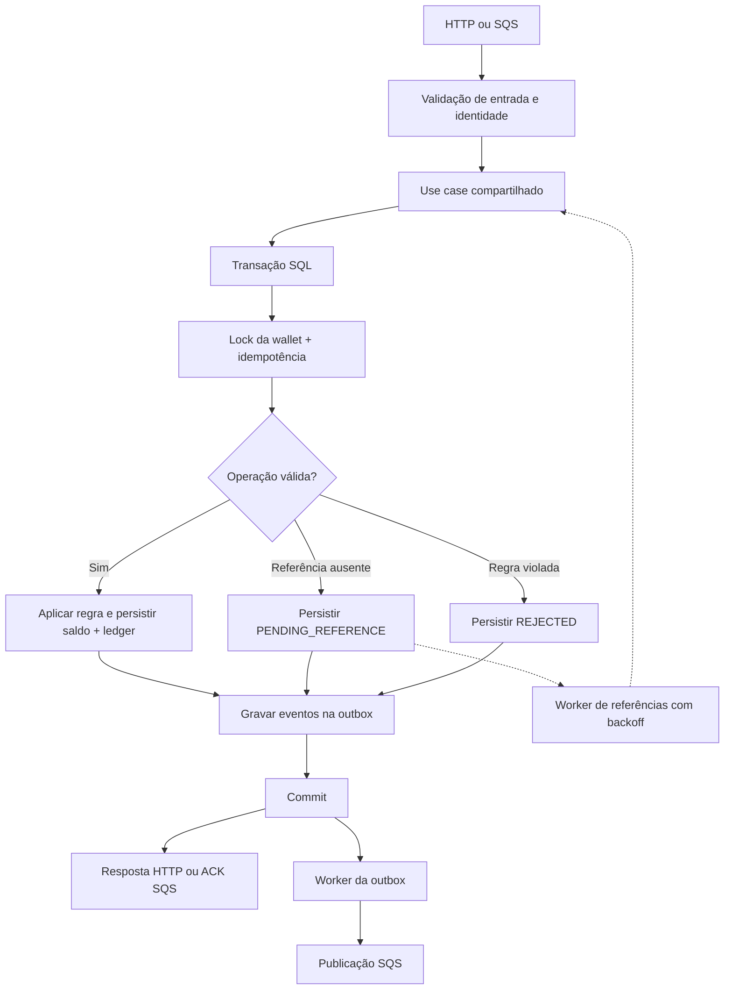

# Distributed Wagering Processor

> Processamento financeiro distribuído de apostas, com consistência de saldo, ledger auditável, idempotência persistente e tolerância a falhas.

Serviço desenvolvido em **NestJS + Bun + PostgreSQL + SQS** para processar operações de múltiplos provedores (`BET`, `WIN`, `LOSS`, `REFUND` e `ROLLBACK`) por HTTP ou mensageria. O projeto foi desenhado para lidar com **entrega at-least-once**, mensagens **duplicadas ou fora de ordem** e **múltiplas instâncias concorrentes**.

O foco não é CRUD: é preservar a correção financeira mesmo diante de concorrência, redelivery e falhas entre etapas do processamento.

**Documentação:** [Enunciado](docs/CHALLENGE.md) · [Decisões arquiteturais](ARCHITECTURE.md) · [Especificação técnica](docs/TECH_SPEC.md) · [Teste de carga](docs/LOAD_TEST.md)

## Garantias essenciais

- **Dinheiro exato:** valores representados em `bigint` (centavos), nunca em ponto flutuante.
- **Saldo não negativo:** operações financeiras com controle transacional e concorrência por wallet.
- **Idempotência persistente:** reenvios não podem gerar novos débitos ou créditos; payload divergente sob a mesma chave é conflito.
- **Ledger auditável:** cada movimentação de saldo tem lançamento correspondente; a consistência é verificável por reconciliação.
- **Publicação segura:** eventos são registrados na mesma transação SQL e publicados posteriormente via transactional outbox.
- **Recuperação:** mensagens repetidas, referências ausentes e falhas temporárias são tratadas por mecanismos persistentes.
- **Defesa no banco:** constraints, índices e triggers dão suporte às invariantes, além das validações de domínio.

> As garantias acima representam o desenho e o comportamento esperado da implementação. A verificação prática está coberta pelos comandos de testes descritos abaixo.

## Stack

| Componente | Tecnologia |
|---|---|
| Runtime, gerenciador de pacotes e testes | Bun 1.x |
| Linguagem | TypeScript (`strict`) |
| Framework | NestJS |
| Banco de dados | PostgreSQL 16 |
| ORM e transações | MikroORM (`EntityManager.transactional()`, `FOR UPDATE`) |
| Mensageria | AWS SQS, emulado localmente com MiniStack (LocalStack compatível; ADR-013) |
| Orquestração | Docker Compose |
| Migrações | Versionadas e reversíveis (`up`/`down`) |
| Observabilidade | Pino (logs JSON), Prometheus e health checks |
| Autenticação opcional | JWT/JWKS via Keycloak |

## Início rápido

**Pré-requisitos:** [Bun 1.x](https://bun.sh) e Docker com Docker Compose.

```bash
# 1. Subir PostgreSQL, emulador SQS e filas (incluindo DLQ)
docker compose up -d

# 2. Instalar dependências
bun install

# 3. Configurar variáveis de ambiente
cp .env.example .env

# 4. Aplicar migrations (tabelas, constraints e triggers)
bun run migration:up

# 5. Iniciar API, consumer e workers
bun run start:dev
```

A API fica disponível em `http://localhost:3000`. Os valores padrão do `.env.example` são pensados para o ambiente do Compose.

Para iniciar **três instâncias**, execute `bun run start:cluster` (portas `3000`, `3001` e `3002`). Cada processo executa API, consumer e workers; a coordenação é feita no PostgreSQL, sem líder único.

### Comandos úteis

| Comando | Finalidade |
|---|---|
| `bun run migration:up` | Aplicar migrations |
| `bun run migration:down` | Reverter a última migration |
| `bun run start:dev` | Iniciar uma instância |
| `bun run start:cluster` | Iniciar três instâncias |
| `bun run test:unit` | Testar domínio e regras isoladas |
| `bun run test:integration` | Testar com PostgreSQL e SQS reais em containers |
| `bun run test:concurrency` | Testar paralelismo e múltiplas instâncias |
| `bun test` | Executar a suíte completa |
| `bun run test:load` | Executar teste de carga |
| `bun run lint && bun run typecheck` | Validar qualidade e tipos |

## Como funciona

### Fluxo de processamento



**1. Entrada e validação.** A borda valida o payload; HTTP exige `Idempotency-Key`. HTTP e SQS reutilizam o mesmo caso de uso.

**2. Serialização por wallet.** Dentro de uma transação SQL, a aplicação bloqueia a wallet (`SELECT ... FOR UPDATE`) e verifica a idempotência. Uma chave existente com o mesmo hash representa replay; com hash diferente, conflito (`409`).

**3. Movimentação atômica.** As regras de domínio determinam o resultado. A persistência da transação, do saldo (com update condicionado por versão), do ledger e da outbox ocorre na mesma transação SQL. Quando a origem é SQS, o registro de inbox também participa dessa unidade atômica.

**4. Confirmação e publicação.** A resposta HTTP ou o ACK SQS ocorre após o commit. Um worker independente publica os eventos da outbox com controle de concorrência por lease e `SKIP LOCKED`.

**5. Referências fora de ordem.** Um `REFUND` ou `ROLLBACK` recebido antes da transação referenciada permanece em `PENDING_REFERENCE` (`202` em HTTP). Um worker tenta resolvê-lo com backoff por até 24 horas, conforme o desenho documentado.

### Regras das operações

| Operação | Efeito no saldo | Ledger | Regra principal |
|---|---|---|---|
| `BET` | Débito | `DEBIT` | Rejeita saldo insuficiente |
| `WIN` | Crédito | `CREDIT` | Registra ganho |
| `LOSS` | Nenhum | Nenhum | Registra resultado sem alterar saldo |
| `REFUND` | Crédito | `CREDIT` | Reverte uma `BET` processada |
| `ROLLBACK` | Inverso da referência | Entrada inversa | Reverte uma operação elegível já processada |

`REFUND` e `ROLLBACK` exigem referência válida, pertencente ao mesmo contexto de provedor, jogador, wallet, moeda e rodada. O valor da reversão deve ser integral. O desenho usa índice único parcial para impedir compensações duplicadas de uma referência, inclusive entre `REFUND` e `ROLLBACK`.

### Por que essas estratégias?

**Lock pessimista por wallet.** Mantém duas operações da mesma wallet serializadas, sem introduzir lock global: wallets diferentes podem avançar em paralelo. Um cenário-chave é uma wallet com `100.00 BRL` recebendo duas apostas simultâneas de `80.00 BRL`: espera-se um débito, uma rejeição e saldo final `20.00 BRL`.

**Idempotência no PostgreSQL.** `UNIQUE (idempotency_key)` e `UNIQUE (provider_id, external_transaction_id)` impedem que uma duplicata dependa da memória de um processo. O hash dos campos de negócio diferencia replay legítimo de chave reutilizada com payload conflitante.

**Inbox + transactional outbox.** A inbox evita reexecutar mensagens já tratadas. A outbox evita publicar antes do commit e permite retomar eventos confirmados após uma queda. A entrega de eventos continua sendo **at-least-once**: consumidores devem deduplicar por `eventId`; não se promete exactly-once no transporte.

**Reconciliação.** A API compara o saldo materializado ao saldo reconstruído pelo ledger. Divergências são expostas, registradas em log e contabilizadas em métrica, sem correção silenciosa.

Detalhes de transições, locks, falhas, constraints, hash canônico e trade-offs: [ARCHITECTURE.md](ARCHITECTURE.md).

## API HTTP

| Método | Endpoint | Uso |
|---|---|---|
| `POST` | `/wallets` | Criar wallet |
| `GET` | `/wallets/:walletId` | Consultar saldo |
| `GET` | `/wallets/:walletId/ledger?cursor=&limit=50` | Consultar ledger paginado |
| `GET` | `/wagering/transactions/:transactionId` | Consultar transação interna |
| `GET` | `/providers/:providerId/wagering/transactions/:externalTransactionId` | Consultar por referência externa |
| `POST` | `/wagering/transactions` | Submeter operação |
| `POST` | `/wallets/:walletId/reconciliation` | Reconciliação |
| `GET` | `/health/live` | Liveness |
| `GET` | `/health/ready` | Readiness (PostgreSQL + três filas) |
| `GET` | `/metrics` | Métricas Prometheus |

### Criar uma wallet

```http
POST /wallets
Content-Type: application/json
```

```json
{
  "playerId": "0192f28f-5dc0-7d58-bdb2-814ad6a0f4a1",
  "initialBalance": { "amount": "1000.00", "currency": "BRL" }
}
```

**Resposta `201` (exemplo):**

```json
{
  "id": "0192f291-27dd-7d3f-8071-5f8685deef37",
  "playerId": "0192f28f-5dc0-7d58-bdb2-814ad6a0f4a1",
  "balance": { "amount": "1000.00", "currency": "BRL" },
  "version": 1
}
```

Saldo inicial positivo gera uma operação interna `OPENING` e um lançamento `CREDIT` na mesma transação SQL. `playerId` + moeda duplicados retornam `409 WALLET_ALREADY_EXISTS`.

### Submeter uma aposta

```http
POST /wagering/transactions
Content-Type: application/json
Idempotency-Key: provider-a:transaction-123
```

```json
{
  "providerId": "provider-a",
  "externalTransactionId": "transaction-123",
  "playerId": "0192f28f-5dc0-7d58-bdb2-814ad6a0f4a1",
  "walletId": "0192f291-27dd-7d3f-8071-5f8685deef37",
  "roundId": "round-987",
  "gameId": "fortune-chimp",
  "kind": "BET",
  "money": { "amount": "25.00", "currency": "BRL" }
}
```

**Resposta `201` (exemplo):**

```json
{
  "transactionId": "0192f298-345e-7e38-af88-e43f851a819d",
  "status": "PROCESSED",
  "balance": { "amount": "975.00", "currency": "BRL" },
  "failureCode": null,
  "idempotentReplay": false
}
```

Se a mesma requisição for reenviada com a mesma chave e payload, a resposta preserva o resultado originalmente registrado e indica `idempotentReplay: true`.

### Semântica de respostas

| HTTP | Significado |
|---|---|
| `201` | Nova transação processada |
| `200` | Replay idempotente |
| `202` | Aguardando referência (`PENDING_REFERENCE`) |
| `400` | Payload inválido |
| `409` | Conflito de idempotência ou duplicidade |
| `422` | Rejeição por regra de negócio, com `failureCode` |
| `503` | Infraestrutura temporariamente indisponível |

Erros usam `application/problem+json`, com `code` estável e indicação `retryable` para orientar o provedor.

### Reconciliação

```http
POST /wallets/0192f291-27dd-7d3f-8071-5f8685deef37/reconciliation
```

```json
{
  "walletId": "0192f291-27dd-7d3f-8071-5f8685deef37",
  "storedBalance": { "amount": "975.00", "currency": "BRL" },
  "calculatedBalance": { "amount": "975.00", "currency": "BRL" },
  "difference": { "amount": "0.00", "currency": "BRL" },
  "consistent": true,
  "checkedEntries": 42,
  "chainValid": true
}
```

Se houver divergência, `consistent` retorna `false`; o sistema não altera silenciosamente o histórico.

## Testes e validação

Os testes de integração utilizam infraestrutura separada da de desenvolvimento, com PostgreSQL e SQS em containers — sem substituir esses serviços por mocks.

```bash
docker compose -f docker-compose.test.yml up -d
bun test
```

O ambiente de teste utiliza as portas `55432` e `54566`. Cada arquivo de integração cria um banco descartável e aplica as migrations reais.

| Camada | Cenários descritos |
|---|---|
| Unidade | `Money`, agregados, regras de transição e conflitos de moeda/idempotência |
| Integração | Migrations e constraints, atomicidade wallet/ledger/inbox/outbox, redelivery, retry/DLQ, publishers concorrentes e reinício |
| Concorrência e falhas | 50 apostas idênticas simultâneas, hot wallet, pelo menos três processos, crash entre commit e ACK, referências fora de ordem e indisponibilidade de PostgreSQL/SQS |
| Carga | Modelo aberto, métricas de desempenho e verificação de consistência ao final |

Ao final dos testes de integração e concorrência, `assertWalletConsistent` verifica:

```text
wallet.balance == saldo reconstruído pelo ledger
```

Também verifica ausência de saldo negativo e continuidade da cadeia de versões. Os testes de carga exigem reconciliação das wallets, ausência de duplicados e outbox drenada. Metodologia, resultados e limitações: [docs/LOAD_TEST.md](docs/LOAD_TEST.md).

## Mensageria e execução distribuída

O projeto utiliza filas SQS, incluindo fila de transações e DLQ. O consumer reaproveita o caso de uso HTTP, registra deduplicação em inbox persistente e só confirma a mensagem após o commit. Erros transitórios são tratados com retry/backoff; falhas permanentes seguem a política de DLQ documentada.

A execução com `bun run start:cluster` inicia três processos independentes. Não há eleição de líder: row locks, `SKIP LOCKED` e leases coordenam os workers pelo PostgreSQL.

## Segurança e autenticação

Autenticação é **opcional e desativada por padrão**, conforme o escopo do desafio. Quando `AUTH_ENABLED=true`, o `AuthGuard` valida JWT Bearer usando JWKS de um provedor de identidade externo, como Keycloak, e compara o claim `azp` com o `providerId` enviado; token ausente/inválido resulta em `401` e divergência de identidade em `403`.

```bash
docker compose -f docker-compose.auth.yml up -d
# No .env: AUTH_ENABLED=true e variáveis AUTH_* configuradas para o realm
```

`/health/*` e `/metrics` permanecem públicos. O ambiente Keycloak e o fluxo client-credentials são descritos em [ARCHITECTURE.md](ARCHITECTURE.md) (ADR-011).

## Observabilidade

- **Logs estruturados:** Pino com `correlationId`, `messageId`, `transactionId`, `walletId` e `providerId`, propagados via `AsyncLocalStorage`; redaction de credenciais, payloads completos e dados financeiros sensíveis.
- **Métricas Prometheus:** transações por status, duplicatas, tentativas, DLQ, conflitos de lock, outbox lag/pendências, referências pendentes, latência e divergências de reconciliação.
- **Health checks:** liveness do processo e readiness de PostgreSQL e das três filas, com timeout de 1 segundo.

## Configuração e decisões

As variáveis disponíveis estão em [.env.example](.env.example), com validação no boot; consulte [docs/TECH_SPEC.md](docs/TECH_SPEC.md) (§11) para os detalhes.

A documentação de arquitetura registra mapeamento de `Money`, estratégia transacional, locks, hash canônico, máquina de estados, `failureCode`, inbox/outbox, referências fora de ordem, autenticação, trade-offs e limitações conhecidas.

**Leitura recomendada para avaliação:** comece por este README para executar a aplicação; siga para [ARCHITECTURE.md](ARCHITECTURE.md) para entender as decisões e para [docs/TECH_SPEC.md](docs/TECH_SPEC.md) para os contratos e detalhes de implementação.
