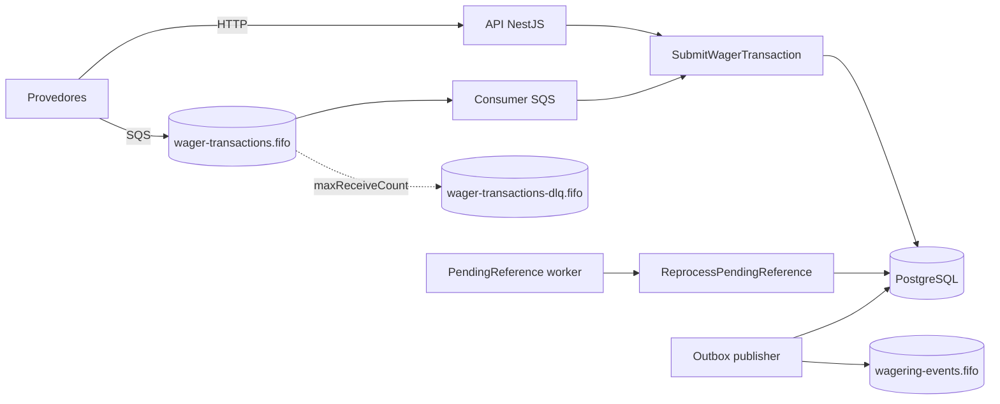
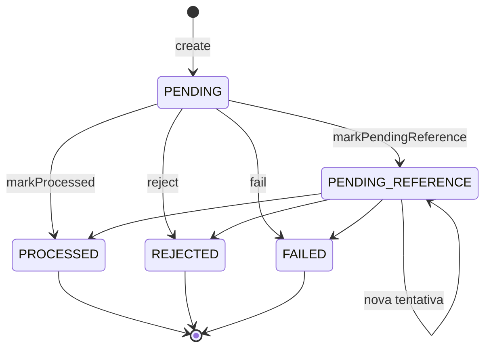

# Tech Spec — Distributed Wagering Processor

| | |
|---|---|
| Status | Aprovada para implementação |
| Fonte do requisito | `docs/CHALLENGE.md` (enunciado original) |
| Guia de execução | `AGENTS.md` |
| Data | 2026-10-10 |

Precedência em caso de conflito: **enunciado → esta spec → AGENTS.md**. Divergências encontradas durante a implementação são registradas na §15 e levadas ao humano.

---

## 1. Objetivo e escopo

Serviço financeiro que recebe operações de apostas (`BET`, `WIN`, `LOSS`, `REFUND`, `ROLLBACK`) de múltiplos provedores de jogos, por HTTP e por SQS, mantendo saldo de wallets e um ledger auditável, correto sob entrega at-least-once, fora de ordem e com várias instâncias concorrentes.

### 1.1 Garantias (invariantes globais)

| ID | Garantia | Onde é aplicada |
|---|---|---|
| G1 | Sem crédito ou débito duplicado | idempotência (`UNIQUE`), lock por wallet, `UNIQUE (transaction_id, wallet_id)` no ledger, compensação única (ADR-001) |
| G2 | Saldo nunca negativo | domínio + `CHECK (balance_amount >= 0)` + `CHECK (balance_after >= 0)` |
| G3 | Saldo materializado == ledger | mesma transação SQL + cadeia de versões + constraint trigger deferida |
| G4 | Ledger imutável | trigger que bloqueia `UPDATE`/`DELETE`/`TRUNCATE` |
| G5 | Nenhum evento confirmado é perdido; nenhum evento sai antes do commit | transactional outbox |
| G6 | Correto com N instâncias | todo estado de coordenação vive no PostgreSQL |

### 1.2 Fora de escopo

- Reversão parcial; câmbio entre moedas (modelo multi-moeda, operação em `BRL`).
- Autenticação implementada (ver ADR-011): entregue como ponto de extensão, com o desenho alvo documentado.
- Diferenciais não planejados: partidas dobradas, OpenTelemetry e dashboard. O único diferencial planejado é o teste de carga (§12.2).
- Consumidores dos eventos publicados.

---

## 2. Visão de arquitetura



Todas as instâncias são idênticas e rodam API, consumer e workers. Não há líder; a coordenação usa row locks, `SKIP LOCKED` e leases no PostgreSQL.

### 2.1 Módulos e camadas

| Módulo | Domínio | Aplicação | Infra |
|---|---|---|---|
| `shared` | `Money`, `DomainError`, `FailureCode`, portas `Clock`/`IdGenerator` | — | logger, métricas, correlação (`AsyncLocalStorage`), config |
| `wallet` | `Wallet`, `WalletLedgerEntry` | `OpenWallet`, `GetWallet`, `ListLedger`, `ReconcileWallet` | entidades MikroORM + mappers, controllers |
| `wagering` | `WagerTransaction`, `ReferencePolicy`, `PayloadHasher` | `SubmitWagerTransaction`, `ReprocessPendingReference`, `GetTransaction` | persistência, controller, consumer SQS |
| `messaging` | `InboxMessage`, `OutboxMessage`, `IntegrationEvent` | `PublishOutbox` | repositórios, publisher SQS, loops dos workers |
| `health`, `auth` | — | — | terminus/custom, `AuthGuard` no-op |

Regra de dependência: `domain` não importa NestJS, MikroORM, AWS SDK nem pino, nem código de `application` ou `infra`; `application` não importa `infra`. A regra é garantida por lint (`no-restricted-imports` por pasta), não só por convenção, e o lint roda junto com os testes. Entidades de persistência são separadas das de domínio (ADR-007).

---

## 3. Modelo de domínio

### 3.1 Money (ADR-003, ADR-006)

- Interno: `bigint` em centavos, escala fixa 2; moeda `^[A-Z]{3}$`. Imutável.
- `Money.from({amount, currency})` aceita **somente** `^(0|[1-9]\d*)\.\d{2}$` e tipo `string`. Qualquer outra forma → `InvalidMoneyError` (`INVALID_PAYLOAD`).
- Magnitude máxima: `999999999999999999.99` (cabe em `NUMERIC(20,2)`).
- `add`/`subtract` entre moedas diferentes → `CurrencyMismatchError`.
- `subtract` pode produzir negativo (uso interno); quem decide se é permitido é o agregado.
- `toJSON()` → `{amount: "25.00", currency: "BRL"}`. Nunca serializar `bigint` diretamente.

### 3.2 Wallet

Estado: `id, playerId, currency, balance, version, createdAt, updatedAt`.

| Operação | Pré-condições | Efeito |
|---|---|---|
| `open({id, playerId, initialBalance, transactionId, at})` | `initialBalance >= 0` | `version = 1`; se `initialBalance > 0`, retorna `WalletLedgerEntry` `CREDIT` de `0 → initialBalance` com `walletVersion = 1` |
| `debit(money, transactionId, at)` | mesma moeda; `balance >= money` senão `InsufficientFundsError` | `balance -= money`, `version++`, retorna entry `DEBIT` |
| `credit(money, transactionId, at)` | mesma moeda | `balance += money`, `version++`, retorna entry `CREDIT` |
| `reverse(direction, money, transactionId, at)` | igual a debit/credit; saldo insuficiente → `ReversalInsufficientFundsError` | idem |

`debit`/`credit`/`reverse` **retornam** o `WalletLedgerEntry` criado; não existe forma de mudar saldo sem obter um lançamento. `version` só muda quando o saldo muda.

### 3.3 WalletLedgerEntry

Campos: `id, seq (persistência), walletId, transactionId, direction, money, balanceBefore, balanceAfter, walletVersion, createdAt`. Todos `readonly`. `create` valida `balanceBefore ± money === balanceAfter`, `money > 0`, `balanceAfter >= 0` e moedas iguais.

### 3.4 WagerTransaction

#### Kinds e regras

| Kind | Origem | Referência | Efeito no saldo | Ledger |
|---|---|---|---|---|
| `OPENING` | interna (`POST /wallets`) | — | crédito | 1 `CREDIT` |
| `BET` | API/SQS | proibida | débito | 1 `DEBIT` |
| `WIN` | API/SQS | opcional → `BET` | crédito | 1 `CREDIT` |
| `LOSS` | API/SQS | opcional → `BET` | nenhum | nenhum |
| `REFUND` | API/SQS | obrigatória → `BET` | crédito | 1 `CREDIT` |
| `ROLLBACK` | API/SQS | obrigatória → `BET`/`WIN`/`REFUND` | inverso da referência | 1 invertido |

Validação de referência (quando presente), nesta ordem, primeira falha vence:

1. `REFUND`/`ROLLBACK` sem `referenceExternalTransactionId` → `REFERENCE_REQUIRED` (validação de payload, HTTP 400).
2. `BET` com referência → `INVALID_PAYLOAD`.
3. Referência não encontrada por `(providerId, referenceExternalTransactionId)` → `PENDING_REFERENCE`.
4. Referência em `PENDING`/`PENDING_REFERENCE` → `PENDING_REFERENCE`.
5. Kind da referência incompatível → `INVALID_REFERENCE_KIND`.
6. Player, wallet, moeda ou rodada diferentes → `REFERENCE_MISMATCH`.
7. Referência `REJECTED`/`FAILED` → `REFERENCE_NOT_PROCESSED`.
8. Valor diferente (só `REFUND`/`ROLLBACK`) → `AMOUNT_MISMATCH`.
9. Referência já compensada (só `REFUND`/`ROLLBACK`) → `REFERENCE_ALREADY_REVERSED` (ADR-001).
10. Efeito no saldo: `BET` sem saldo → `INSUFFICIENT_FUNDS`; reversão sem saldo → `REVERSAL_INSUFFICIENT_FUNDS`.

Interpretações adotadas:
- `WIN` pode ocorrer mais de uma vez por `BET` (jogos com múltiplos prêmios); o valor do `WIN` é livre.
- `LOSS` com referência não "consome" a `BET`; uma `BET` com `LOSS` ainda pode receber `REFUND`/`ROLLBACK`.
- `ROLLBACK` de `ROLLBACK` não é suportado (`INVALID_REFERENCE_KIND`).

#### Máquina de estados



- `PENDING` existe em memória durante o processamento síncrono; não é persistido nesta arquitetura (toda submissão termina a transação SQL em `PROCESSED`, `REJECTED` ou `PENDING_REFERENCE`). O enum e o `CHECK` aceitam o valor para preservar o contrato.
- Transição a partir de estado terminal → `InvalidTransactionStateError` (bug, HTTP 500). Reforçado por trigger (§4.2).
- `FAILED` / `PROCESSING_FAILED`: reservado para erro permanente não-negócio detectado em transação já persistida, por exemplo inconsistência de dados ao reprocessar uma `PENDING_REFERENCE`. Erros de infraestrutura em requisição nova **não** gravam `FAILED` (não há como gravar com o banco fora); viram 503 / retry.

### 3.5 Payload hash (ADR-008)

Campos, todos obrigatórios no objeto hasheado (ausente → `null`):

```
providerId, externalTransactionId, playerId, walletId, roundId, gameId,
kind, money: { amount, currency }, referenceExternalTransactionId
```

Algoritmo: JSON canônico (chaves ordenadas lexicograficamente em todos os níveis, sem espaços, strings como recebidas, UTF-8) → SHA-256 → hex minúsculo → prefixo `v1:`. Não entram: header `Idempotency-Key`, `messageId`, `occurredAt`, `type`, headers de transporte.

Vetor de teste (fixar valor real no teste unitário):

```json
{"externalTransactionId":"transaction-123","gameId":"fortune-chimp","kind":"BET","money":{"amount":"25.00","currency":"BRL"},"playerId":"0192f28f-5dc0-7d58-bdb2-814ad6a0f4a1","providerId":"provider-a","referenceExternalTransactionId":null,"roundId":"round-987","walletId":"0192f291-27dd-7d3f-8071-5f8685deef37"}
```

### 3.6 Transação interna OPENING

| Campo | Valor |
|---|---|
| `provider_id` | `__system__` (inválido pela regex de `providerId` da API, sem colisão possível) |
| `external_transaction_id` | `opening:{walletId}` |
| `idempotency_key` | `__system__:opening:{walletId}` |
| `round_id`, `game_id` | `NULL` (permitido somente para `OPENING`) |
| `status` | `PROCESSED` |

Validação de `providerId` na entrada: `^[a-z0-9][a-z0-9-]{0,63}$`. `kind = OPENING` na entrada → 400 `INVALID_PAYLOAD`.

---

## 4. Persistência

PostgreSQL 16. MikroORM com migrations versionadas, cada uma com `up` e `down`; constraints e triggers em SQL explícito. Dinheiro em `NUMERIC(20,2)`, lido pelo driver como `string` e convertido para `bigint` por custom type (nenhum parser numérico registrado para `NUMERIC`).

### 4.1 DDL de referência

```sql
-- ============ wallets ============
CREATE TABLE wallets (
  id              UUID PRIMARY KEY,
  player_id       UUID NOT NULL,
  currency        CHAR(3) NOT NULL CHECK (currency ~ '^[A-Z]{3}$'),
  balance_amount  NUMERIC(20,2) NOT NULL CHECK (balance_amount >= 0),
  version         INTEGER NOT NULL CHECK (version >= 1),
  created_at      TIMESTAMPTZ NOT NULL,
  updated_at      TIMESTAMPTZ NOT NULL,
  CONSTRAINT uq_wallets_player_currency UNIQUE (player_id, currency)
);

-- ============ wager_transactions ============
CREATE TABLE wager_transactions (
  id                                UUID PRIMARY KEY,
  provider_id                       TEXT NOT NULL,
  external_transaction_id           TEXT NOT NULL,
  idempotency_key                   TEXT NOT NULL,
  payload_hash                      TEXT NOT NULL,
  requested_wallet_id               UUID NOT NULL,
  wallet_id                         UUID NULL REFERENCES wallets(id),
  player_id                         UUID NOT NULL,
  round_id                          TEXT NULL,
  game_id                           TEXT NULL,
  kind                              TEXT NOT NULL CHECK (kind IN ('OPENING','BET','WIN','LOSS','REFUND','ROLLBACK')),
  amount                            NUMERIC(20,2) NOT NULL CHECK (amount > 0),
  currency                          CHAR(3) NOT NULL CHECK (currency ~ '^[A-Z]{3}$'),
  reference_external_transaction_id TEXT NULL,
  reference_transaction_id          UUID NULL REFERENCES wager_transactions(id),
  status                            TEXT NOT NULL CHECK (status IN ('PENDING','PENDING_REFERENCE','PROCESSED','REJECTED','FAILED')),
  failure_code                      TEXT NULL,
  result_balance_amount             NUMERIC(20,2) NULL,
  reference_attempts                INTEGER NOT NULL DEFAULT 0,
  next_reference_attempt_at         TIMESTAMPTZ NULL,
  reference_deadline_at             TIMESTAMPTZ NULL,
  correlation_id                    TEXT NOT NULL,
  created_at                        TIMESTAMPTZ NOT NULL,
  processed_at                      TIMESTAMPTZ NULL,

  CONSTRAINT uq_wtx_idempotency_key UNIQUE (idempotency_key),
  CONSTRAINT uq_wtx_provider_external UNIQUE (provider_id, external_transaction_id),
  CONSTRAINT ck_wtx_reference_required
    CHECK (kind NOT IN ('REFUND','ROLLBACK') OR reference_external_transaction_id IS NOT NULL),
  CONSTRAINT ck_wtx_bet_no_reference
    CHECK (kind <> 'BET' OR reference_external_transaction_id IS NULL),
  CONSTRAINT ck_wtx_opening_is_system
    CHECK ((kind = 'OPENING') = (provider_id = '__system__')),
  CONSTRAINT ck_wtx_round_game
    CHECK (kind = 'OPENING' OR (round_id IS NOT NULL AND game_id IS NOT NULL)),
  CONSTRAINT ck_wtx_wallet_resolved          -- ADR-002
    CHECK (wallet_id IS NOT NULL OR (status = 'REJECTED' AND failure_code = 'WALLET_NOT_FOUND')),
  CONSTRAINT ck_wtx_failure_code
    CHECK ((status IN ('REJECTED','FAILED')) = (failure_code IS NOT NULL)),
  CONSTRAINT ck_wtx_processed_at
    CHECK ((status = 'PROCESSED') = (processed_at IS NOT NULL)),
  CONSTRAINT ck_wtx_result_balance
    CHECK (status NOT IN ('PROCESSED','REJECTED') OR result_balance_amount IS NOT NULL
           OR failure_code = 'WALLET_NOT_FOUND'),
  CONSTRAINT ck_wtx_pending_reference      -- ADR-004
    CHECK (status <> 'PENDING_REFERENCE'
           OR (next_reference_attempt_at IS NOT NULL AND reference_deadline_at IS NOT NULL))
);

-- ADR-001: compensação única
CREATE UNIQUE INDEX uq_wtx_single_compensation
  ON wager_transactions (reference_transaction_id)
  WHERE status = 'PROCESSED' AND kind IN ('REFUND','ROLLBACK');

CREATE INDEX ix_wtx_reference_lookup
  ON wager_transactions (provider_id, reference_external_transaction_id)
  WHERE reference_external_transaction_id IS NOT NULL;

CREATE INDEX ix_wtx_pending_reference_due
  ON wager_transactions (next_reference_attempt_at)
  WHERE status = 'PENDING_REFERENCE';

-- ============ wallet_ledger_entries (append-only) ============
CREATE TABLE wallet_ledger_entries (
  id              UUID PRIMARY KEY,
  seq             BIGINT GENERATED ALWAYS AS IDENTITY UNIQUE,
  wallet_id       UUID NOT NULL REFERENCES wallets(id),
  transaction_id  UUID NOT NULL REFERENCES wager_transactions(id),
  direction       TEXT NOT NULL CHECK (direction IN ('DEBIT','CREDIT')),
  amount          NUMERIC(20,2) NOT NULL CHECK (amount > 0),
  currency        CHAR(3) NOT NULL,
  balance_before  NUMERIC(20,2) NOT NULL CHECK (balance_before >= 0),
  balance_after   NUMERIC(20,2) NOT NULL CHECK (balance_after >= 0),
  wallet_version  INTEGER NOT NULL CHECK (wallet_version >= 1),
  created_at      TIMESTAMPTZ NOT NULL,

  CONSTRAINT uq_ledger_tx_wallet UNIQUE (transaction_id, wallet_id),
  CONSTRAINT uq_ledger_wallet_version UNIQUE (wallet_id, wallet_version),
  CONSTRAINT ck_ledger_arithmetic CHECK (
    (direction = 'CREDIT' AND balance_after = balance_before + amount) OR
    (direction = 'DEBIT'  AND balance_after = balance_before - amount))
);

CREATE INDEX ix_ledger_wallet_seq ON wallet_ledger_entries (wallet_id, seq);

-- ============ inbox ============
CREATE TABLE inbox_messages (
  consumer_name  TEXT NOT NULL,
  message_id     TEXT NOT NULL,
  payload_hash   TEXT NOT NULL,
  received_at    TIMESTAMPTZ NOT NULL,
  processed_at   TIMESTAMPTZ NULL,
  PRIMARY KEY (consumer_name, message_id)
);

-- ============ outbox ============
CREATE TABLE outbox_messages (
  id               UUID PRIMARY KEY,          -- = eventId
  aggregate_id     TEXT NOT NULL,
  event_type       TEXT NOT NULL,
  payload          JSONB NOT NULL,
  occurred_at      TIMESTAMPTZ NOT NULL,
  attempts         INTEGER NOT NULL DEFAULT 0 CHECK (attempts >= 0),
  next_attempt_at  TIMESTAMPTZ NOT NULL,
  locked_until     TIMESTAMPTZ NULL,
  locked_by        TEXT NULL,
  published_at     TIMESTAMPTZ NULL,
  last_error       TEXT NULL
);

CREATE INDEX ix_outbox_due ON outbox_messages (next_attempt_at) WHERE published_at IS NULL;
```

### 4.2 Triggers

| Trigger | Tabela | Regra |
|---|---|---|
| `trg_ledger_immutable` | `wallet_ledger_entries` | `BEFORE UPDATE OR DELETE` → `RAISE EXCEPTION`; `BEFORE TRUNCATE` (statement) → `RAISE EXCEPTION` |
| `trg_ledger_chain` | `wallet_ledger_entries` | `BEFORE INSERT`: se existe entrada com `wallet_version = NEW.wallet_version - 1`, exige `NEW.balance_before = prev.balance_after`; se não existe, exige `NEW.balance_before = 0` e `NEW.wallet_version IN (1, 2)` |
| `trg_wallet_guard` | `wallets` | `BEFORE UPDATE`: proíbe alterar `id`, `player_id`, `currency`, `created_at`; se `balance_amount` mudou exige `NEW.version = OLD.version + 1`, senão exige `NEW.version = OLD.version`; `BEFORE DELETE` → exceção |
| `trg_wallet_ledger_consistency` | `wallets` | `CONSTRAINT TRIGGER ... AFTER INSERT OR UPDATE DEFERRABLE INITIALLY DEFERRED`: no commit, exige lançamento com `(wallet_id, wallet_version, balance_after) = (NEW.id, NEW.version, NEW.balance_amount)`, exceto `version = 1 AND balance_amount = 0` |
| `trg_wtx_guard` | `wager_transactions` | `BEFORE UPDATE`: exceção se `OLD.status` terminal; exceção se mudar `id, provider_id, external_transaction_id, idempotency_key, payload_hash, requested_wallet_id, wallet_id, player_id, kind, amount, currency, reference_external_transaction_id, created_at`; `BEFORE DELETE` → exceção |
| `trg_outbox_guard` | `outbox_messages` | `BEFORE UPDATE`: proíbe alterar `id, aggregate_id, event_type, payload, occurred_at`; proíbe alterar `published_at` já preenchido |

Exceções dos triggers usam `ERRCODE` próprio (`P0001` + mensagem com prefixo `invariant_violation:`) para o mapeamento de erro identificar violação de invariante (HTTP 500, log `error`, métrica).

Testes de schema (§12) inserem/alteram linhas **via SQL direto** para provar que cada constraint e trigger dispara independentemente do código.

---

## 5. Concorrência (ADR-005)

- Toda operação que pode mudar saldo: `em.transactional()` → `SET LOCAL lock_timeout = :LOCK_TIMEOUT_MS` → `SELECT ... FROM wallets WHERE id = $1 FOR UPDATE`.
- Toda leitura que decide algo (idempotência, referência, compensação, saldo) acontece **depois** do lock. Por isso `READ COMMITTED` basta.
- Update condicionado: `UPDATE wallets SET balance_amount=$b, version=version+1, updated_at=$t WHERE id=$id AND version=$v`. `rowCount = 0` → erro de invariante (não deveria ocorrer sob lock).
- Uma transação toca uma wallet; não há ordenação de locks entre wallets.
- `lock_timeout` estourado (`55P03`) → erro transitório → HTTP 503 `Retry-After` / SQS backoff; `lock_conflicts_total++`.
- Pool de conexões dimensionado para `concorrência do consumer + workers + margem HTTP`; documentado no README.

Alternativa descartada: optimistic locking com retry. Em hot wallet, gera tempestade de retries e latência imprevisível; com `FOR UPDATE` a fila de espera é do próprio PostgreSQL.

---

## 6. Fluxos

### 6.1 Submeter transação (HTTP e SQS — mesmo use case)

```mermaid
sequenceDiagram
  participant S as Fonte (HTTP/SQS)
  participant U as SubmitWagerTransaction
  participant DB as PostgreSQL
  S->>U: comando validado + payloadHash + source
  U->>DB: BEGIN
  opt source = SQS
    U->>DB: INSERT inbox ON CONFLICT DO NOTHING
    alt já existia
      U->>DB: COMMIT
      U-->>S: Duplicate (ack)
    end
  end
  U->>DB: SET LOCAL lock_timeout; SELECT wallet FOR UPDATE
  alt wallet não existe (ADR-002)
    U->>DB: INSERT tx REJECTED/WALLET_NOT_FOUND ON CONFLICT (idempotency_key) DO NOTHING
    U->>DB: se inseriu: INSERT outbox (Rejected)
    U->>DB: se não inseriu: SELECT tx → replay ou conflito
  else wallet existe
    U->>DB: SELECT tx WHERE idempotency_key (replay/conflito → retorna)
    U->>DB: SELECT tx WHERE provider_id, external_transaction_id (conflito → retorna)
    U->>U: create + resolver referência + aplicar no agregado
    U->>DB: INSERT tx, UPDATE wallet (condicionado), INSERT ledger
    U->>DB: INSERT outbox (Processed|Rejected|PendingReference [+ BalanceChanged])
  end
  opt source = SQS
    U->>DB: UPDATE inbox SET processed_at
  end
  U->>DB: COMMIT
  U-->>S: resultado (SQS: ack só agora)
```

Conflitos de idempotência retornam **sem gravar** a transação; a inbox (quando SQS) é gravada, para a mensagem não ser reprocessada.

Violação `23505` em `uq_wtx_idempotency_key` / `uq_wtx_provider_external` em qualquer ponto → `ROLLBACK`, nova transação de leitura, resolver como replay ou conflito. Nunca 500.

### 6.2 Replay

- O resultado é montado **somente** da linha persistida: `status`, `failure_code`, `result_balance_amount`, `id`.
- Terminal: sempre a resposta original (saldo observado naquele momento — regra 7).
- `PENDING_REFERENCE`: devolve o estado atual (pode já ter virado terminal). Documentado como comportamento esperado.

### 6.3 Criar wallet

`BEGIN` → `INSERT wallets (version 1)` → se saldo > 0: `INSERT wager_transactions (OPENING, PROCESSED)` + `INSERT ledger (CREDIT, wallet_version 1)` + outbox `WagerTransactionProcessed` e `WalletBalanceChanged` → `COMMIT`. `23505` em `uq_wallets_player_currency` → 409 `WALLET_ALREADY_EXISTS`. A wallet não tem idempotency key; repetir a criação devolve 409 (o provedor consulta por `GET`).

### 6.4 Reprocessar `PENDING_REFERENCE` (ADR-004)

```
loop a cada PENDING_REFERENCE_POLL_MS:
  BEGIN
    SELECT id FROM wager_transactions
     WHERE status='PENDING_REFERENCE' AND next_reference_attempt_at <= now()
     ORDER BY next_reference_attempt_at LIMIT :batch FOR UPDATE SKIP LOCKED
  COMMIT                                  -- só para escolher candidatos
  para cada id: BEGIN
     SELECT wallet FOR UPDATE; SELECT tx FOR UPDATE (revalida status)
     tenta resolver referência
       resolvida  → mesmo caminho de aplicação do §6.1 (ledger, outbox, terminal)
       não        → se now() < deadline: attempts++, next = now() + backoff(attempts)
                    senão (tentativa final já feita agora): REJECTED REFERENCE_NOT_FOUND + outbox
  COMMIT
```

- Backoff: `min(1s × 2^attempts, 5 min)` com jitter ±20%. Prazo: `created_at + 24h`.
- O lock da wallet vem antes do lock da transação (mesma ordem do fluxo síncrono → sem deadlock).
- Gatilho imediato: ao fazer commit de qualquer transação `PROCESSED`, na mesma transação SQL: `UPDATE wager_transactions SET next_reference_attempt_at = now() WHERE status='PENDING_REFERENCE' AND provider_id=$p AND reference_external_transaction_id=$ext` (não viola o guard: não é terminal e não altera colunas de identidade).

### 6.5 Publicar outbox (ADR-009)

```
loop a cada OUTBOX_POLL_MS:
  claim (transação curta):
    UPDATE outbox_messages SET locked_until = now() + :LEASE, locked_by = :instanceId
     WHERE id IN (SELECT id FROM outbox_messages
                   WHERE published_at IS NULL AND next_attempt_at <= now()
                     AND (locked_until IS NULL OR locked_until < now())
                   ORDER BY occurred_at LIMIT :batch FOR UPDATE SKIP LOCKED)
    RETURNING *
  fora de transação: SendMessageBatch para wagering-events.fifo
    MessageGroupId = aggregateId ; MessageDeduplicationId = eventId ; body = payload
  por mensagem:
    ok    → UPDATE SET published_at=now(), locked_until=NULL WHERE id=$id AND locked_by=:instanceId
    falha → attempts++, next_attempt_at = now() + backoff, last_error, locked_until=NULL
```

- Instância morre com lease → lease expira (`OUTBOX_LEASE_MS`, default 30s) → outra publica. Duplicata possível e segura: mesmo `eventId`; SQS FIFO deduplica na janela de 5 min e consumidores deduplicam por `eventId`.
- Sem limite de tentativas: evento confirmado nunca é descartado. `attempts` alto → log `error` + métrica `outbox_publish_failures_total`.
- `aggregateId` = `walletId` (ordenação por wallet dentro do FIFO). Para `WALLET_NOT_FOUND`, `requested_wallet_id`.

### 6.6 Consumer SQS (ADR-010)

- `ReceiveMessage`: `WaitTimeSeconds=20`, `MaxNumberOfMessages=10`, `VisibilityTimeout=SQS_VISIBILITY_TIMEOUT_S` (default 60), `MessageSystemAttributeNames=[ApproximateReceiveCount]`.
- Concorrência por instância: `SQS_CONSUMER_CONCURRENCY` (default 10), mensagens processadas em paralelo, uma transação SQL por mensagem.
- `consumerName` = `wager-transactions-consumer` (constante, igual em todas as instâncias).

| Resultado | Classe | Ação |
|---|---|---|
| `PROCESSED`, `REJECTED`, `PENDING_REFERENCE`, replay, conflito de idempotência | negócio | commit → `DeleteMessage` |
| Inbox duplicada | negócio | `DeleteMessage`; `idempotency_duplicates_total{source="sqs"}++` |
| Envelope/JSON/schema inválido, `type` desconhecido, `kind=OPENING`, mesmo `messageId` com hash diferente | permanente | `SendMessage` para DLQ (atributos `failureCode`, `originalMessageId`) → `DeleteMessage` |
| Conexão PG, `lock_timeout`, serialization failure, throttling | transitório | não deleta; `ChangeMessageVisibility(backoff(receiveCount))` com `backoff = min(2^n s, 300 s)` |
| `ApproximateReceiveCount >= SQS_MAX_RECEIVE_COUNT` (default 5) em transitório | esgotado | redrive automático para a DLQ (`RedrivePolicy.maxReceiveCount` igual) |
| Violação de invariante (bug) | permanente | DLQ + log `error` |

Shutdown (`SIGTERM`): para o polling → aguarda in-flight até `SHUTDOWN_GRACE_MS` (default 25s) → `ChangeMessageVisibility(0)` nas recebidas não iniciadas → para workers de outbox e referência (liberando leases) → fecha ORM. Mensagem em processamento além do grace: a transação faz rollback ao fechar a conexão e a mensagem reaparece após o visibility timeout.

Fault injection (somente `NODE_ENV=test`): `FAULT_INJECTION=exit_after_commit_before_ack` faz `process.exit(137)` entre o `COMMIT` e o `DeleteMessage`.

---

## 7. API HTTP

Formato de erro: `application/problem+json`

```json
{
  "type": "https://errors.wagering.local/insufficient-funds",
  "title": "Insufficient funds",
  "status": 422,
  "code": "INSUFFICIENT_FUNDS",
  "retryable": false,
  "correlationId": "…",
  "errors": [{ "path": "money.amount", "message": "…" }]
}
```

`X-Correlation-Id` aceito na requisição (gerado se ausente) e sempre devolvido.

### 7.1 Mapeamento de status (consistente em todos os endpoints)

| Situação | Status |
|---|---|
| Criado / transação nova `PROCESSED` | `201` |
| Replay de `PROCESSED`; consultas | `200` |
| `PENDING_REFERENCE` (novo ou replay) | `202` |
| Payload, header ou query inválido | `400` `INVALID_PAYLOAD` / `REFERENCE_REQUIRED` |
| Conflito de idempotência / duplicidade | `409` `IDEMPOTENCY_KEY_CONFLICT` / `DUPLICATE_EXTERNAL_TRANSACTION` / `WALLET_ALREADY_EXISTS` |
| Rejeição de negócio (nova ou replay) | `422` com corpo de transação |
| Recurso inexistente em `GET` | `404` `NOT_FOUND` |
| Infraestrutura indisponível, `lock_timeout` | `503` `INFRA_UNAVAILABLE`, `Retry-After`, `retryable: true` |
| Violação de invariante / bug | `500` `INTERNAL_ERROR` |

### 7.2 Endpoints

**`POST /wallets`** → `201`

```json
// request
{ "playerId": "uuid", "initialBalance": { "amount": "1000.00", "currency": "BRL" } }
// response
{ "id": "uuid", "playerId": "uuid", "balance": { "amount": "1000.00", "currency": "BRL" }, "version": 1 }
```

**`GET /wallets/:walletId`** → `200` mesmo corpo + `createdAt`, `updatedAt`.

**`GET /wallets/:walletId/ledger?cursor=&limit=50`** → `200`

```json
{
  "items": [{
    "id": "uuid", "transactionId": "uuid", "direction": "DEBIT",
    "money": { "amount": "25.00", "currency": "BRL" },
    "balanceBefore": { "amount": "1000.00", "currency": "BRL" },
    "balanceAfter":  { "amount": "975.00",  "currency": "BRL" },
    "walletVersion": 2, "createdAt": "ISO-8601"
  }],
  "nextCursor": "opaque-or-null"
}
```

Cursor: base64url de `{"v":1,"seq":<n>}`; ordem ascendente por `seq`; `limit` 1–200. Cursor malformado → 400.

**`POST /wagering/transactions`** (header `Idempotency-Key` obrigatório, 1–255 chars)

```json
// request
{
  "providerId": "provider-a", "externalTransactionId": "transaction-123",
  "playerId": "uuid", "walletId": "uuid", "roundId": "round-987", "gameId": "fortune-chimp",
  "kind": "BET", "money": { "amount": "25.00", "currency": "BRL" },
  "referenceExternalTransactionId": "opcional"
}
// response (201/200/202/422)
{
  "transactionId": "uuid",
  "status": "PROCESSED",
  "balance": { "amount": "975.00", "currency": "BRL" },
  "failureCode": null,
  "idempotentReplay": false
}
```

`balance` é `null` somente em `WALLET_NOT_FOUND` e em `PENDING_REFERENCE`.

**`GET /wagering/transactions/:transactionId`** e **`GET /providers/:providerId/wagering/transactions/:externalTransactionId`** → `200`

```json
{
  "id": "uuid", "providerId": "…", "externalTransactionId": "…", "walletId": "uuid|null",
  "playerId": "uuid", "roundId": "…", "gameId": "…", "kind": "REFUND",
  "money": { "amount": "25.00", "currency": "BRL" },
  "referenceExternalTransactionId": "…", "referenceTransactionId": "uuid|null",
  "status": "PROCESSED", "failureCode": null,
  "resultBalance": { "amount": "1000.00", "currency": "BRL" },
  "createdAt": "ISO-8601", "processedAt": "ISO-8601|null"
}
```

**`POST /wallets/:walletId/reconciliation`** → `200` (corpo do enunciado + `chainValid: boolean`). Calcula `Σ CREDIT − Σ DEBIT`, verifica cadeia (`balance_before` = `balance_after` anterior, versões contínuas). Divergência: log `warn` com `walletId`, `difference`; `reconciliation_mismatches_total++`; `consistent: false`. Nunca corrige. Lê com `REPEATABLE READ` para snapshot coerente entre wallet e ledger.

**`GET /health/live`**, **`GET /health/ready`** (sem auth), **`GET /metrics`** (Prometheus, sem auth — documentado como rede interna).

---

## 8. Mensageria

### 8.1 Filas (criadas pelo init do LocalStack)

| Fila | Tipo | Configuração |
|---|---|---|
| `wager-transactions.fifo` | entrada | `ContentBasedDeduplication=false`, `VisibilityTimeout=60`, `RedrivePolicy={deadLetterTargetArn: dlq, maxReceiveCount: 5}` |
| `wager-transactions-dlq.fifo` | DLQ | retenção 14 dias |
| `wagering-events.fifo` | saída (outbox) | `ContentBasedDeduplication=false` |

Produtores da fila de entrada usam `MessageGroupId = walletId` e `MessageDeduplicationId = messageId` (otimização; a correção não depende disso).

### 8.2 Contrato de entrada

Envelope do enunciado (`messageId`, `type = "WagerTransactionRequested"`, `occurredAt`, `data`). `data` segue o mesmo schema do `POST /wagering/transactions`, com `idempotencyKey` obrigatório no lugar do header.

### 8.3 Eventos de integração

Envelope (`IntegrationEvent.toJSON()`): `eventId, eventType, aggregateId, correlationId, causationId?, occurredAt, version, data`. Uma subclasse por evento com `eventType`/`version` no tipo; `data` só com tipos JSON (`MoneyProps`).

| Evento | v | Quando | `data` |
|---|---|---|---|
| `WagerTransactionProcessed` | 1 | toda transação `PROCESSED`, inclusive `LOSS` e `OPENING` | `transactionId, providerId, externalTransactionId, walletId, playerId, roundId, gameId, kind, money, referenceTransactionId?, balanceAfter, processedAt` |
| `WagerTransactionRejected` | 1 | toda transação `REJECTED` (inclusive prazo de referência) | `transactionId, providerId, externalTransactionId, walletId?, requestedWalletId, kind, money, failureCode, rejectedAt` |
| `WalletBalanceChanged` | 1 | somente com lançamento no ledger | `walletId, transactionId, direction, money, balanceBefore, balanceAfter, walletVersion` |
| `WagerTransactionPendingReference` | 1 | ao entrar em `PENDING_REFERENCE` (uma vez, não a cada tentativa) | `transactionId, providerId, externalTransactionId, walletId, kind, referenceExternalTransactionId, deadlineAt` |

`correlationId`: do request/mensagem. `causationId`: `messageId` (SQS) ou `Idempotency-Key` (HTTP); no reprocessamento, o `id` da transação.

---

## 9. Taxonomia de `failureCode`

| Código | Onde aparece | HTTP | Terminal | Ação do provedor |
|---|---|---|---|---|
| `INVALID_PAYLOAD` | validação | 400 | sim | corrigir e enviar com nova key |
| `REFERENCE_REQUIRED` | validação | 400 | sim | corrigir |
| `IDEMPOTENCY_KEY_CONFLICT` | idempotência | 409 | sim | não reenviar com a mesma key |
| `DUPLICATE_EXTERNAL_TRANSACTION` | idempotência | 409 | sim | investigar |
| `WALLET_ALREADY_EXISTS` | criação de wallet | 409 | sim | consultar wallet existente |
| `WALLET_NOT_FOUND` | transação `REJECTED` | 422 | sim | corrigir `walletId` (ADR-002) |
| `WALLET_PLAYER_MISMATCH` | `REJECTED` | 422 | sim | corrigir |
| `CURRENCY_MISMATCH` | `REJECTED` | 422 | sim | corrigir |
| `INSUFFICIENT_FUNDS` | `REJECTED` | 422 | sim | desistir |
| `REVERSAL_INSUFFICIENT_FUNDS` | `REJECTED` | 422 | sim | escalar operacionalmente |
| `INVALID_REFERENCE_KIND` | `REJECTED` | 422 | sim | corrigir |
| `REFERENCE_MISMATCH` | `REJECTED` | 422 | sim | corrigir |
| `REFERENCE_NOT_PROCESSED` | `REJECTED` | 422 | sim | desistir |
| `AMOUNT_MISMATCH` | `REJECTED` | 422 | sim | corrigir |
| `REFERENCE_ALREADY_REVERSED` | `REJECTED` | 422 | sim | desistir — já compensada (ADR-001) |
| `REFERENCE_NOT_FOUND` | `REJECTED` após prazo | evento | sim | investigar (ADR-004) |
| `PROCESSING_FAILED` | `FAILED` | evento / 500 | sim | escalar |
| `INFRA_UNAVAILABLE` | erro transitório | 503 | não | reenviar a mesma requisição com backoff |
| `INTERNAL_ERROR` | bug | 500 | — | escalar |

Rejeições `REJECTED` são persistidas e entram em replay; erros 400/409/503 não criam transação.

---

## 10. Observabilidade

**Logs** (pino JSON): campos de contexto `correlationId, messageId, transactionId, walletId, providerId, instanceId`; `redact` para `*.money`, `*.balance*`, `*.amount`, `headers.authorization`, corpo completo de requisições/mensagens. Níveis: `info` para resultado de cada transação (status, kind, failureCode, durationMs), `warn` para replay/conflito/reconciliação divergente, `error` para invariante/DLQ.

**Métricas** (`GET /metrics`):

| Métrica | Tipo | Labels |
|---|---|---|
| `wager_transactions_total` | counter | `status, kind, source` |
| `idempotency_duplicates_total` | counter | `source` (`http`, `sqs_inbox`, `sqs_idempotency`), `outcome` (`replay`, `conflict`) |
| `processing_retries_total` | counter | `reason` |
| `dlq_messages_total` | counter | `reason` |
| `lock_conflicts_total` | counter | — |
| `outbox_lag_seconds` | gauge | — (idade do evento não publicado mais antigo) |
| `outbox_pending_messages` | gauge | — |
| `outbox_publish_failures_total` | counter | — |
| `pending_reference_transactions` | gauge | — |
| `wager_processing_duration_seconds` | histogram | `source, status` |
| `reconciliation_mismatches_total` | counter | — |

Gauges de outbox/pending são atualizados por um coletor periódico (consulta indexada), não em cada request.

**Health**: `live` sem dependências; `ready` = `SELECT 1` + `GetQueueAttributes` nas três filas, timeout 1s cada, 503 se falhar.

---

## 11. Configuração

| Variável | Default | Uso |
|---|---|---|
| `DATABASE_URL` | — | PostgreSQL |
| `DB_POOL_MAX` | `20` | pool |
| `LOCK_TIMEOUT_MS` | `2000` | `SET LOCAL lock_timeout` |
| `AWS_ENDPOINT_URL`, `AWS_REGION` | LocalStack, `us-east-1` | SQS |
| `SQS_INPUT_QUEUE`, `SQS_DLQ`, `SQS_EVENTS_QUEUE` | nomes da §8.1 | |
| `SQS_CONSUMER_CONCURRENCY` | `10` | |
| `SQS_VISIBILITY_TIMEOUT_S` | `60` | |
| `SQS_MAX_RECEIVE_COUNT` | `5` | igual ao redrive |
| `OUTBOX_POLL_MS` / `OUTBOX_BATCH` / `OUTBOX_LEASE_MS` | `500` / `50` / `30000` | |
| `PENDING_REFERENCE_POLL_MS` / `PENDING_REFERENCE_TTL_MS` / `PENDING_REFERENCE_MAX_BACKOFF_MS` | `1000` / `86400000` / `300000` | ADR-004 |
| `SHUTDOWN_GRACE_MS` | `25000` | |
| `INSTANCE_ID` | hostname + pid | leases, logs |
| `FAULT_INJECTION` | vazio | só em `NODE_ENV=test` |

Config validada no boot (falha rápido se inválida).

---

## 12. Plano de testes

Infra: `docker-compose.test.yml` (PostgreSQL + LocalStack). Schema via migrations reais. Banco isolado por arquivo de teste (schema dedicado), filas com sufixo único. `Clock` injetável para tempo. Sem `sleep` fixo: `eventually(fn, timeout)`. `assertWalletConsistent(walletId)` ao fim de todo teste de integração/concorrência.

### 12.1 Matriz de testes

| ID | Arquivo | Cenário | Critério |
|---|---|---|---|
| U1 | `unit/money.test.ts` | tabela de entradas válidas/ inválidas, aritmética, moeda, serialização | sem `number` em lugar nenhum |
| U2 | `unit/wallet.test.ts` | open/debit/credit/reverse, versão, saldo insuficiente | |
| U3 | `unit/wager-transaction.test.ts` | máquina de estados, terminais, regras por kind, validação de referência (ordem §3.4) | |
| U4 | `unit/payload-hash.test.ts` | vetor fixo, ordem de chaves irrelevante, campos de transporte ignorados | |
| U5 | `unit/ledger-entry.test.ts` | aritmética validada na factory | |
| I1 | `integration/schema.test.ts` | `up→down→up`; cada constraint e trigger da §4 dispara via SQL direto | |
| I2 | `integration/atomicity.test.ts` | falha injetada antes do commit → nada em wallet/ledger/tx/inbox/outbox | |
| I3 | `integration/idempotency.test.ts` | replay idêntico (todas as respostas), conflito de hash, conflito provider/external, replay de rejeição | |
| I4 | `integration/references.test.ts` | todas as regras da §3.4; ADR-001: REFUND+ROLLBACK na mesma BET (sequencial) → um crédito; ROLLBACK de REFUND; segundo ROLLBACK rejeitado | |
| I5 | `integration/wallet-not-found.test.ts` | ADR-002: rejeição persistida, replay estável após a wallet ser criada | |
| I6 | `integration/sqs-inbox.test.ts` | redelivery da mesma mensagem → 1 efeito; `messageId` reusado com outro payload → DLQ | |
| I7 | `integration/sqs-retry-dlq.test.ts` | transitório → retry com backoff; esgotado → DLQ; permanente → DLQ imediata | |
| I8 | `integration/reconciliation.test.ts` | consistente; divergência forçada (via role de teste) → `consistent:false`, métrica, sem correção | |
| I9 | `integration/shutdown.test.ts` | `SIGTERM` com mensagens em voo → concluídas ou visíveis de novo | |
| C1 | `concurrency/same-bet-50x.test.ts` | mesma aposta 50× paralela | 1 débito, 1×201 + 49×200 idênticos |
| C2 | `concurrency/hot-wallet.test.ts` | 100.00, duas apostas de 80.00 | 1 `PROCESSED`, 1 `INSUFFICIENT_FUNDS`, saldo 20.00, 1 débito |
| C3 | `concurrency/parallel-wallets.test.ts` | 20 wallets × 20 operações | todas consistentes |
| C4 | `concurrency/multi-instance.test.ts` | 3 processos `Bun.spawn` (HTTP + consumer) sobre as mesmas wallets | invariantes + nenhum duplicado |
| C5 | `concurrency/crash-after-commit.test.ts` | `exit_after_commit_before_ack`; outra instância recebe a redelivery | 1 efeito, inbox impede reprocesso |
| C6 | `concurrency/outbox-publishers.test.ts` | 2+ publishers; um morto com lease | todo evento publicado ≥ 1×, duplicatas com mesmo `eventId` |
| C7 | `concurrency/out-of-order.test.ts` | REFUND/ROLLBACK antes da BET; prazo vencido (Clock); REFUND+ROLLBACK concorrentes na mesma BET (ADR-001) | |
| C8 | `concurrency/restart.test.ts` | matar todas as instâncias no meio da carga e subir de novo | consistência final + outbox drenada |
| C9 | `concurrency/hot-wallet-stress.test.ts` | 1 wallet, 300 operações misturadas (BET, WIN, LOSS, REFUND, ROLLBACK, duplicatas) distribuídas entre 3 instâncias | saldo nunca negativo, nenhum duplicado, cadeia de versões contínua, contagem de lançamentos = transações com efeito |
| I10 | `integration/postgres-outage.test.ts` | `docker pause` no Postgres durante carga HTTP e SQS, depois `unpause` | HTTP devolve 503 `INFRA_UNAVAILABLE` (nunca 500 nem 2xx falso); mensagens SQS voltam por visibilidade e são processadas depois; consistência final |
| I11 | `integration/sqs-outage.test.ts` | `docker pause` no LocalStack com transações sendo gravadas | API continua respondendo; `outbox_lag_seconds` cresce; após `unpause` a outbox drena e todo evento é publicado; `ready` vai a 503 e volta a 200 |
| A1 | lint | regra de dependência entre camadas (§2.1) | `bun run lint` falha se `domain` importar framework ou infra |

Os testes I10 e I11 controlam os containers do `docker-compose.test.yml` pelo CLI do Docker (`docker pause`/`unpause`), com helpers em `test/support/chaos.ts`. São os únicos testes que dependem do Docker CLI; o README diz isso.

Critério de aceite da suíte: 10 execuções seguidas de `bun test` sem falha.

### 12.2 Teste de carga (diferencial)

O enunciado valoriza a qualidade do experimento e a honestidade da análise mais que o número. O teste de carga também prova correção **sob carga**, não só vazão.

**Comando:** `bun run test:load` (perfil padrão) ou `bun run test:load -- --scenario=<nome>`.

**Gerador:** script Bun em `test/load/run.ts`, sem dependência externa, em **modelo aberto** (taxa de chegada constante, disparando requisições num agendamento fixo, sem esperar a anterior). Isso evita o *coordinated omission*: se o sistema fica lento, as requisições continuam chegando e a latência medida inclui o tempo de fila. A latência de cada requisição é medida do horário **agendado** até a resposta.

**Ambiente:** `start:cluster` com 3 instâncias; o gerador distribui as requisições entre as portas em round-robin. Postgres e LocalStack do `docker-compose.yml`. O relatório registra CPU, RAM, SO, versões (Bun, Postgres, LocalStack), recursos do Docker, `DB_POOL_MAX`, `SQS_CONSUMER_CONCURRENCY` e se gerador e serviço estão na mesma máquina.

**Cenários:**

| Cenário | O que mede | Configuração |
|---|---|---|
| `distributed` | vazão com contenção baixa | 1.000 wallets, mistura 70% BET, 20% WIN, 5% LOSS, 5% REFUND; degraus de taxa crescentes até a taxa de erro passar de 1% ou o p99 passar de 1s |
| `hot-wallet` | o teto de uma wallet só (custo do lock pessimista, ADR-005) | todas as operações em 1 wallet; mesmos degraus |
| `duplicates` | custo da idempotência | `distributed` com 20% de reenvios idênticos |
| `sqs` | vazão do consumidor e atraso ponta a ponta | N mensagens enfileiradas; mede o tempo de `SendMessage` até a transação persistida |

**Protocolo por degrau:** 30 s de aquecimento descartados, 120 s medidos, 3 repetições; o relatório usa a mediana das repetições e mostra a dispersão.

**Métricas coletadas:**
- vazão aceita (respostas 2xx e 422 por segundo);
- latência p50, p95, p99 e máxima, calculadas sobre todas as amostras do degrau;
- taxa de erro por classe (409, 422, 503, 5xx, timeout do cliente);
- conflitos de lock (diferença de `lock_conflicts_total` no `/metrics` antes e depois);
- atraso da outbox (`outbox_lag_seconds`, amostrado a cada 1 s; relatar p95 e máximo), e tempo para drenar depois que a carga para;
- para `sqs`: mensagens por segundo e p50/p95/p99 ponta a ponta.

**Verificação de correção após cada execução:** reconciliação de todas as wallets tocadas (`consistent: true` em 100%), nenhuma transação duplicada por `(provider_id, external_transaction_id)`, outbox drenada. Uma execução que falha nessa verificação invalida os números e vira bug.

**Saída:** resultados brutos em JSON em `test/load/results/<data>-<cenário>.json` (fora do git, exceto os usados no relatório) e o relatório `docs/LOAD_TEST.md` com:
1. ambiente e metodologia;
2. tabela por cenário e degrau;
3. gráfico de latência por taxa (imagem gerada a partir do JSON, com o script versionado);
4. análise: onde está o gargalo (pool de conexões, lock da wallet, CPU, LocalStack) e como isso foi verificado;
5. limitações honestas: gerador e serviço na mesma máquina, LocalStack não é SQS real, Docker em notebook não é produção.

Um resumo de três a cinco linhas vai para "Resultados medidos" no `ARCHITECTURE.md`.

---

## 13. Registro de decisões (ADRs)

| ADR | Decisão | Status |
|---|---|---|
| 001 | **Compensação única**: REFUND e ROLLBACK mutuamente exclusivos sobre a mesma referência; ROLLBACK de REFUND permitido; garantido por índice único parcial. Leitura literal da regra 4 permitiria crédito em dobro. | Aceita (humano) |
| 002 | **Wallet inexistente é rejeição persistida** (`REJECTED`/`WALLET_NOT_FOUND`, 422), com `requested_wallet_id` e `wallet_id` nulo só nesse caso. Auditável e replay estável. | Aceita (humano) |
| 003 | **`amount` com exatamente 2 casas** na entrada, sem normalização; `number` JSON rejeitado. | Aceita (humano) |
| 004 | **`PENDING_REFERENCE` com prazo de 24h**, backoff até 5 min, tentativa final após o prazo, reprocessamento imediato quando a referência chega. | Aceita (humano) |
| 005 | Pessimistic lock por wallet (`FOR UPDATE` + `lock_timeout`) + update condicionado por versão + constraints. | Aceita |
| 006 | `Money` em `bigint` (centavos), `NUMERIC(20,2)` lido como string. | Aceita |
| 007 | MikroORM com entidades de persistência separadas do domínio + mappers via `rehydrate`. | Aceita |
| 008 | Payload hash: SHA-256 de JSON canônico do subconjunto de negócio, prefixo de versão `v1:`. | Aceita |
| 009 | Outbox com lease + `SKIP LOCKED`, publicação fora da transação, sem limite de tentativas, dedup por `eventId`. | Aceita |
| 010 | Classificação de erros do consumer por tipo; DLQ explícita para permanentes e redrive para transitórios esgotados. | Aceita |
| 011 | Autenticação não implementada: `AuthGuard` no-op + `ProviderIdentityPort`; desenho alvo Keycloak client-credentials por provedor, JWT via JWKS, claim do provider comparado ao `providerId` (mismatch → 403). | Aceita |
| 012 | IDs UUIDv7 (`Bun.randomUUIDv7()`); cursor do ledger por `seq` identity. | Aceita |

Cada ADR é detalhado em `ARCHITECTURE.md` (contexto → decisão → alternativas → consequências).

---

## 14. Limitações conhecidas

- Após `BET → REFUND → ROLLBACK(REFUND)`, a `BET` não pode ser compensada de novo (ADR-001).
- `POST /wallets` não é idempotente por chave; repetição devolve 409.
- Uma hot wallet extrema serializa no lock da linha; throughput por wallet é limitado pela latência de uma transação SQL (aceito: correção > vazão).
- `GET /metrics` sem autenticação (rede interna).
- Publicação de eventos é at-least-once; exatamente-uma-vez depende do consumidor deduplicar por `eventId`.

## 15. Questões em aberto

Nenhuma bloqueante. Divergências descobertas na implementação entram aqui com data e são levadas ao humano.

- **2026-10-10 — Emulador de SQS.** Onde esta spec diz LocalStack, leia "emulador de SQS": o padrão passou a ser o MiniStack (ADR-013), porque o LocalStack recente exige token. Risco a validar no M8: suporte a `ApproximateReceiveCount` e ao redrive para a DLQ.

## 16. Marcos de entrega

1. Esqueleto (Bun, Nest, MikroORM, compose, filas, health, logger, config)
2. `Money` + U1
3. Schema completo + I1
4. Wallet, OPENING, ledger, reconciliação
5. BET/WIN/LOSS via HTTP + idempotência + lock + C1–C3
6. Outbox + C6
7. REFUND/ROLLBACK + worker de referência + I4, I5, C7
8. Consumer SQS + inbox + DLQ + shutdown + I6, I7, I9, I10, I11, C4, C5, C8, C9
9. Métricas e redaction
10. `README.md` e `ARCHITECTURE.md` finais
11. Diferencial: teste de carga (§12.2)
